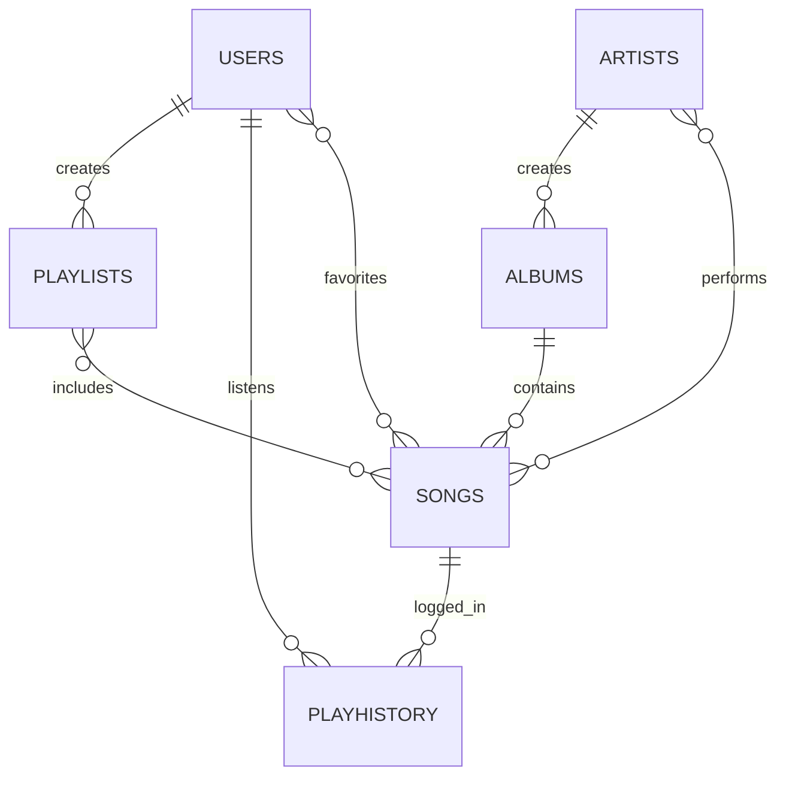

# SYNTHESIA – Real-Time Music Streaming & Analytics Platform

SYNTHESIA is a full-stack music streaming and discovery application built on **Node.js, Express, MongoDB (Mongoose), and React (Vite, TailwindCSS)**.

This repository features an upgraded 6-collection MongoDB database architecture, real music provider integration (Jamendo, MusicBrainz, Apple iTunes, Last.fm), aggregation analytics pipelines, and listening history tracking.

---

## 🏗️ Database Architecture (6 Collections)



### 1. `users`
- Retains bcrypt password hashing, unique email validation, and profile images.
- **Fields:** `name`, `email` (unique, lowercase), `password` (hashed), `image`, `favoriteSongs` (`[ObjectId -> songs]`), `createdAt`, `updatedAt`.

### 2. `artists`
- Represents musicians, bands, or creators. Supports multi-artist tracks and provider deduplication.
- **Fields:** `name`, `bio`, `image`, `country`, `genres`, `externalIds` (`musicbrainz`, `lastfm`, `jamendo`), `createdAt`, `updatedAt`.
- **Indexes:** `name: 1`, `externalIds.musicbrainz: 1` (sparse, unique), `externalIds.jamendo: 1` (sparse, unique).

### 3. `albums`
- Discography records linked to artists via ObjectIds while maintaining color themes and artwork.
- **Fields:** `name`, `desc`, `artistIds` (`[ObjectId -> artists]`), `bgColour`, `image`, `releaseDate`, `albumType`, `externalIds`, `createdAt`, `updatedAt`.
- **Indexes:** `artistIds: 1`, `externalIds.musicbrainz: 1` (sparse, unique), `externalIds.jamendo: 1` (sparse, unique).

### 4. `songs`
- Playable audio tracks with file/stream URLs, artwork, genres, and play counters. Supports backward-compatible string `album` alongside relational `albumId`.
- **Fields:** `name`, `desc`, `artistIds` (`[ObjectId -> artists]`), `albumId` (`ObjectId -> albums`), `album` (legacy string), `genre`, `image`, `file`, `duration` (in seconds), `durationStr`, `releaseDate`, `playCount`, `isExplicit`, `externalIds`, `createdAt`, `updatedAt`.
- **Indexes:** `artistIds: 1`, `albumId: 1`, `genre: 1`, `{ genre: 1, playCount: -1 }`, `externalIds.jamendo: 1` (sparse, unique).

### 5. `playlists`
- User-curated playlists supporting public or private visibility and duplicate-free song arrays (`$addToSet`).
- **Fields:** `name`, `description`, `userId` (`ObjectId -> users`), `songIds` (`[ObjectId -> songs]`), `image`, `isPublic`, `createdAt`, `updatedAt`.
- **Indexes:** `{ userId: 1, createdAt: -1 }`.

### 6. `playhistories`
- Granular event-log of listening sessions. Kept separate from user records to prevent unbounded array document growth.
- **Fields:** `userId` (`ObjectId -> users`), `songId` (`ObjectId -> songs`), `playedAt` (Date), `durationPlayed` (Number in seconds), `createdAt`.
- **Indexes:** `{ userId: 1, playedAt: -1 }`, `songId: 1`, `{ songId: 1, playedAt: -1 }`.

---

## ⚡ Quick Start

### 1. Prerequisites
- Node.js (v18+ recommended)
- MongoDB instance (MongoDB Atlas connection string or local MongoDB)

### 2. Configure Environment Variables
Copy `backend/.env.example` to `backend/.env` and update:
```env
MONGODB_URI=mongodb+srv://<username>:<password>@cluster0.mongodb.net/synthesia
JWT_SECRET=your_jwt_secret_here
PORT=4000
JAMENDO_CLIENT_ID=your_jamendo_client_id
LASTFM_API_KEY=your_lastfm_api_key
MUSICBRAINZ_USER_AGENT=SYNTHESIA/1.0 (contact@example.com)
```

### 3. Setup & Start Backend
```bash
cd backend
npm install
npm run migrate       # Idempotent database migration
npm run verify-db     # Validates collections, indexes & aggregations
npm start             # Starts Express on http://localhost:4000
```

### 4. Setup & Start Frontend
```bash
cd ../frontend
npm install
npm run dev           # Starts Vite on http://localhost:5173
```

---

## 📊 Analytics Aggregations

Implemented in `backend/services/aggregationService.js`:
1. **Genre Distribution:** `genreDistribution()`
2. **Top 10 Most-Played Songs:** `topSongs(limit)`
3. **Song Count per Artist:** `artistSongCount()`
4. **Song Count per Album:** `albumSongCount()`
5. **Total Listening Time per User:** `totalListeningTimePerUser(userId)`
6. **Daily Listening Activity:** `dailyListeningActivity(userId, days)`
7. **Most Active Users:** `mostActiveUsers(limit)`
8. **Most Played Songs from PlayHistory:** `mostPlayedFromHistory(limit)`
9. **User Playlist Statistics:** `playlistStats(userId)`
10. **Artist Catalogue & Discography:** `artistCatalogue(artistId)`

---

## 🎵 Real Music Data Ingestion

Supported data providers:
- **Jamendo API:** Real streamable audio tracks with Creative Commons licenses (`audiodownload_allowed`).
- **MusicBrainz API:** Canonical artist and release metadata with 1-req/sec rate limiting.
- **Apple iTunes Search API:** Rich artwork, track metadata, and release previews.
- **Last.fm API:** Community tags, genres, and track discovery.

Run ingestion via CLI:
```bash
cd backend
npm run import-music -- --genre=electronic --limit=20 --source=jamendo
```
Or trigger via administrative API endpoint:
```http
POST /api/admin/import/music
Headers: { "token": "<jwt_token>" }
Body: { "genre": "ambient", "limit": 20, "source": "jamendo" }
```

---

## 🧪 Testing & Performance Measurement

### Automated Unit & Relationship Tests
Run the comprehensive test suite (74 tests covering models, cross-document relationships, duplicates, CRUD, and aggregations):
```bash
cd backend
npm test
```

### Database Query Execution Plan Analysis
Analyze winning execution plans, key examinations, and index utilization:
```bash
cd backend
npm run perf-test
```

---

## 📚 Detailed Documentation
- [Database Architecture Details](backend/DATABASE_ARCHITECTURE.md)
- [REST API Endpoint Documentation](backend/API_DOCUMENTATION.md)
- [Data Ingestion & Provider Guide](backend/DATA_IMPORT.md)
