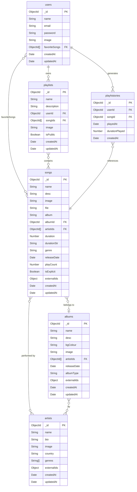

# SYNTHESIA — Database Architecture

## Overview

SYNTHESIA uses **MongoDB** (via Mongoose) with **6 collections**. The diagram below shows all collections and their relationships.

---

## Collection Details

### 1. `users`

Stores registered application users.

| Field | Type | Required | Default | Description |
|---|---|---|---|---|
| `_id` | ObjectId | auto | — | Primary key |
| `name` | String | ✅ | — | Display name |
| `email` | String | ✅ | — | Unique login email |
| `password` | String | ✅ | — | Bcrypt-hashed password |
| `image` | String | — | — | Profile image URL (Cloudinary) |
| `favoriteSongs` | ObjectId[] | — | `[]` | Refs → `songs._id` |
| `createdAt` | Date | auto | — | Mongoose timestamps |
| `updatedAt` | Date | auto | — | Mongoose timestamps |

**Indexes:**
| Field | Type | Purpose |
|---|---|---|
| `email` | Unique | Fast login lookup; enforces uniqueness |

---

### 2. `songs`

Core music track records, enhanced with external ID mapping for data import.

| Field | Type | Required | Default | Description |
|---|---|---|---|---|
| `_id` | ObjectId | auto | — | Primary key |
| `name` | String | ✅ | — | Track title |
| `desc` | String | — | — | Description / lyrics snippet |
| `image` | String | — | — | Cover art URL |
| `file` | String | — | — | Audio file URL (Cloudinary) |
| `album` | String | — | — | Legacy string album name (backward compat) |
| `albumId` | ObjectId | — | — | Ref → `albums._id` |
| `artistIds` | ObjectId[] | — | `[]` | Refs → `artists._id` |
| `duration` | Number | — | `0` | Duration in seconds |
| `durationStr` | String | — | — | Human-readable duration (legacy) |
| `genre` | String | — | — | Genre tag (e.g. "electronic") |
| `releaseDate` | Date | — | — | Official release date |
| `playCount` | Number | — | `0` | Total play count (incremented by history service) |
| `isExplicit` | Boolean | — | `false` | Explicit content flag |
| `externalIds.musicbrainz` | String | — | — | MusicBrainz recording MBID |
| `externalIds.itunes` | String | — | — | iTunes track ID |
| `externalIds.jamendo` | String | — | — | Jamendo track ID (sparse unique) |
| `externalIds.lastfm` | String | — | — | Last.fm track key |
| `createdAt` | Date | auto | — | Mongoose timestamps |
| `updatedAt` | Date | auto | — | Mongoose timestamps |

**Indexes:**
| Field(s) | Type | Purpose |
|---|---|---|
| `artistIds` | Regular | Filter songs by artist |
| `albumId` | Regular | Filter songs by album |
| `genre` | Regular | Genre browsing |
| `genre, playCount DESC` | Compound | Popular songs per genre |
| `externalIds.jamendo` | Sparse Unique | Dedup on import from Jamendo |

---

### 3. `albums`

Music album records with multi-artist support and external ID mapping.

| Field | Type | Required | Default | Description |
|---|---|---|---|---|
| `_id` | ObjectId | auto | — | Primary key |
| `name` | String | ✅ | — | Album title |
| `desc` | String | — | — | Album description |
| `bgColour` | String | — | — | HEX background colour for UI |
| `image` | String | — | — | Album art URL |
| `artistIds` | ObjectId[] | — | `[]` | Refs → `artists._id` |
| `releaseDate` | Date | — | — | Release date |
| `albumType` | String | — | `"album"` | `"album"`, `"single"`, `"ep"`, `"compilation"` |
| `externalIds.musicbrainz` | String | — | — | MusicBrainz release MBID (sparse unique) |
| `externalIds.itunes` | String | — | — | iTunes collection ID |
| `createdAt` | Date | auto | — | Mongoose timestamps |
| `updatedAt` | Date | auto | — | Mongoose timestamps |

**Indexes:**
| Field(s) | Type | Purpose |
|---|---|---|
| `artistIds` | Regular | Albums by artist |
| `externalIds.musicbrainz` | Sparse Unique | Dedup on MusicBrainz import |

---

### 4. `artists`

Artist / band records enriched from external APIs.

| Field | Type | Required | Default | Description |
|---|---|---|---|---|
| `_id` | ObjectId | auto | — | Primary key |
| `name` | String | ✅ | — | Artist / band name |
| `bio` | String | — | — | Biography text |
| `image` | String | — | — | Photo / logo URL |
| `country` | String | — | — | Country of origin |
| `genres` | String[] | — | `[]` | Genre tags |
| `externalIds.musicbrainz` | String | — | — | MusicBrainz artist MBID (sparse unique) |
| `externalIds.lastfm` | String | — | — | Last.fm artist key |
| `createdAt` | Date | auto | — | Mongoose timestamps |
| `updatedAt` | Date | auto | — | Mongoose timestamps |

**Indexes:**
| Field(s) | Type | Purpose |
|---|---|---|
| `name` | Regular | Artist search / lookup |
| `externalIds.musicbrainz` | Sparse Unique | Dedup on MusicBrainz import |

---

### 5. `playlists`

User-created playlists with optional public sharing.

| Field | Type | Required | Default | Description |
|---|---|---|---|---|
| `_id` | ObjectId | auto | — | Primary key |
| `name` | String | ✅ | — | Playlist name |
| `description` | String | — | — | Optional description |
| `userId` | ObjectId | ✅ | — | Ref → `users._id` (owner) |
| `songIds` | ObjectId[] | — | `[]` | Ordered list of refs → `songs._id` |
| `image` | String | — | — | Playlist cover image URL |
| `isPublic` | Boolean | — | `false` | Publicly accessible flag |
| `createdAt` | Date | auto | — | Mongoose timestamps |
| `updatedAt` | Date | auto | — | Mongoose timestamps |

**Indexes:**
| Field(s) | Type | Purpose |
|---|---|---|
| `userId, createdAt DESC` | Compound | User's playlists, newest first |

---

### 6. `playhistories`

Immutable event log of every song play per user.

| Field | Type | Required | Default | Description |
|---|---|---|---|---|
| `_id` | ObjectId | auto | — | Primary key |
| `userId` | ObjectId | ✅ | — | Ref → `users._id` |
| `songId` | ObjectId | ✅ | — | Ref → `songs._id` |
| `playedAt` | Date | — | `Date.now` | When the play started |
| `durationPlayed` | Number | — | — | Seconds actually listened |
| `createdAt` | Date | — | `Date.now` | Record creation timestamp |

**Indexes:**
| Field(s) | Type | Purpose |
|---|---|---|
| `userId, playedAt DESC` | Compound | User listening history, newest first |
| `songId` | Regular | Song-level play lookups |
| `songId, playedAt DESC` | Compound | Trending / popularity analytics |

---

## Relationships Summary

| From Collection | Field | → To Collection | Cardinality |
|---|---|---|---|
| `users` | `favoriteSongs[]` | `songs` | many-to-many |
| `songs` | `albumId` | `albums` | many-to-one |
| `songs` | `artistIds[]` | `artists` | many-to-many |
| `albums` | `artistIds[]` | `artists` | many-to-many |
| `playlists` | `userId` | `users` | many-to-one |
| `playlists` | `songIds[]` | `songs` | many-to-many |
| `playhistories` | `userId` | `users` | many-to-one |
| `playhistories` | `songId` | `songs` | many-to-one |

> [!NOTE]
> MongoDB does not enforce referential integrity. Orphan documents (e.g. a `playhistory` whose `songId` no longer exists) are possible. The migration script `npm run migrate` cleans up orphans as part of the upgrade process.

---

## Full Index Reference

| Collection | Field(s) | Index Type | Purpose |
|---|---|---|---|
| `users` | `email` | Unique | Login uniqueness / fast lookup |
| `songs` | `artistIds` | Regular | Filter songs by artist |
| `songs` | `albumId` | Regular | Filter songs by album |
| `songs` | `genre` | Regular | Genre browsing |
| `songs` | `genre, playCount DESC` | Compound | Popular songs per genre |
| `songs` | `externalIds.jamendo` | Sparse Unique | Jamendo import dedup |
| `albums` | `artistIds` | Regular | Albums by artist |
| `albums` | `externalIds.musicbrainz` | Sparse Unique | MusicBrainz import dedup |
| `artists` | `name` | Regular | Artist name search |
| `artists` | `externalIds.musicbrainz` | Sparse Unique | MusicBrainz import dedup |
| `playlists` | `userId, createdAt DESC` | Compound | User's playlists newest-first |
| `playhistories` | `userId, playedAt DESC` | Compound | User history newest-first |
| `playhistories` | `songId` | Regular | Song play lookups |
| `playhistories` | `songId, playedAt DESC` | Compound | Trending analytics |
